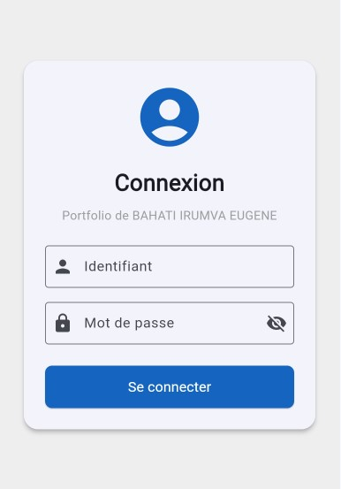
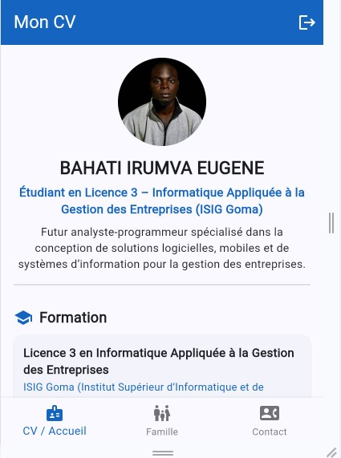
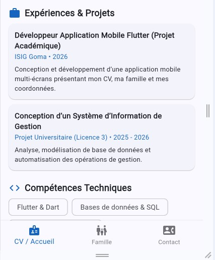
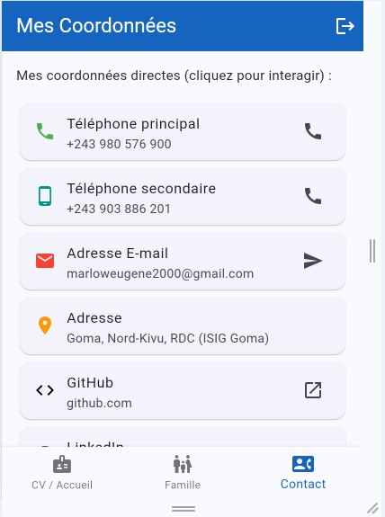

# Application Mobile CV - Flutter (`cv_flutter_eugene`)

Application mobile développée avec **Flutter** par **BAHATI IRUMVA EUGENE** (Étudiant en Licence 3 – Informatique Appliquée à la Gestion des Entreprises à l'**ISIG Goma**).

## Pages réalisées
1. **Page de connexion** : Formulaire sécurisé avec identifiant, mot de passe masqué et bouton « Se connecter ».
2. **Page d'accueil (CV)** : Photo, identité, profil, formation à l'ISIG Goma, expériences, compétences techniques, langues et centres d'intérêt.
3. **Page Famille** : Liste des membres de la famille (Claude, Ange, Innocent, Josephine, Theo, Divine, Kadere) présentée avec `ListView` et `Card`.
4. **Page Contact** : Numéros de téléphone (`+243 980576900`, `+243 903886201`), e-mail (`marloweugene2000@gmail.com`), adresse à Goma et réseaux sociaux cliquables (`url_launcher`).

---

## Captures d'écran de l'application

### 1. Page de Connexion

| Connexion |
| :---: |
|  |

### 2. Page d'Accueil (CV Complet)

| Partie 1 | Partie 2 | Partie 3 |
| :---: | :---: | :---: |
|  |  |  |

| Partie 4 | Partie 5 |
| :---: | :---: |
|  |  |

### 3. Page Famille

| Famille (Partie 1) | Famille (Partie 2) |
| :---: | :---: |
|  |  |

### 4. Page Contact

| Contact (Partie 1) | Contact (Partie 2) |
| :---: | :---: |
|  |  |
